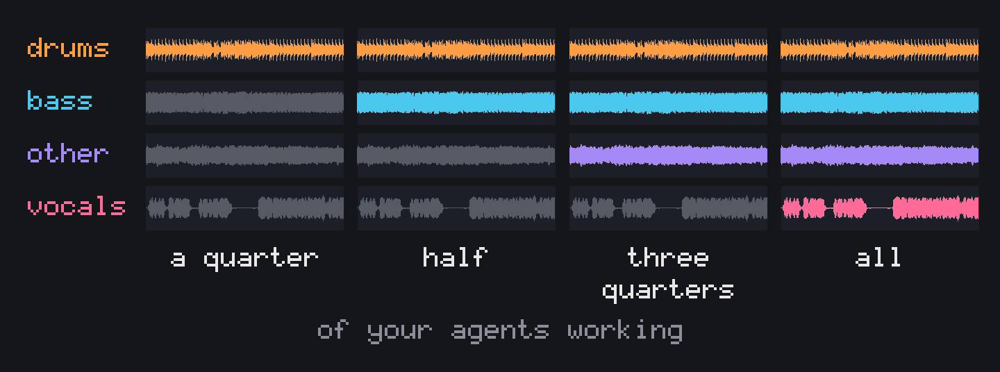

# stemmix

<p align="center"><strong>Music that fills in with the number of Claude Code sessions working right now.</strong></p>

<p align="center">
  <a href="LICENSE"></a>
</p>

<p align="center"></p>

A song from Spotify or Apple Music plays as 4 instrument stems: drums, bass, other, vocals. With k sessions working out of N you hear the first ceil(4k/N) of them: one session is just the drums, N sessions is the whole song, zero is silence. When sessions finish and hand back to you, the room goes quiet without you looking. It runs on macOS, for anyone who keeps several [Claude Code](https://docs.claude.com/en/docs/claude-code/overview) sessions or [herdr](https://herdr.dev) agent panes going at once. stemmix is the tool; `sound-mod` is the repository that holds it.

## Install

Needs macOS, [`uv`](https://docs.astral.sh/uv/getting-started/installation/), and Xcode's command line tools. An Apple Development signing identity in the keychain keeps the audio permission across rebuilds; without one the daemon is signed ad hoc and the permission below has to be given again after every rebuild.

```
git clone https://github.com/federbenjamin/sound-mod && cd sound-mod && ./install.sh
```

Builds the separator's Python environment in `~/.local/share/stemmix/venv` and runs its self-test (the first run downloads the model weights to `~/.cache/demucs-mlx`), builds and signs the daemon as `~/Applications/Stemmix.app`, and installs the launchd agent, which starts it now and at every login.

Then install one session source; each carries the same settings: `tracks`, `player`, `mode`, `muffling_max`, `muffling_min` (what they do: Configuration below):

- Claude Code: add this repo as a plugin marketplace and enable `stemmix@sound-mod` (`/plugin marketplace add <path or owner/repo>`, then `/plugin install stemmix@sound-mod`). Settings, in `/config`.
- herdr: `herdr plugin link <this repo>/herdr-plugin` (or `herdr plugin install <owner>/sound-mod/herdr-plugin` from GitHub). herdr starts it with its server; to start it now, `herdr plugin action invoke restart --plugin stemmix`. Settings: one `key = value` per line in `config.toml` in the folder `herdr plugin config-dir stemmix` prints, for example `tracks = 4`, `mode = "both"`. Needs macOS's own `/usr/bin/python3` (Xcode Command Line Tools).

The first time a session works while music plays, macOS needs Stemmix allowed under System Settings > Privacy & Security > Screen & System Audio Recording > **System Audio Recording Only**: add `~/Applications/Stemmix.app` there with the + button. The daemon never taps before it is allowed, so no prompt appears on its own, and nothing else can raise one for it (not SSH, not a terminal-launched binary: TCC attributes those to the terminal).

The first time you press next with no later song buffered, macOS asks whether Stemmix may control Spotify (or Music). Without it, next there only drops the sound for a moment and the song plays on; you can change it later under System Settings > Privacy & Security > Automation.

## Features

- **One more instrument for each working session.** The song you already have playing comes through as drums, bass, other and vocals, and the count of working sessions decides how many of them you hear.
- **Pause that lands at once.** Pause stops the sound immediately while the music keeps being recorded, so play resumes where you paused. Next and previous move between the songs in the buffer; next with no later song buffered skips the song in Spotify, then plays the new one from its start once it has buffered a few seconds.
- **Media keys, Control Center and headphone buttons.** While attached, the daemon is the system's Now Playing app, and when Spotify starts playing it pulses its play state to take the keys back. Pausing or playing in Spotify itself does the same to the daemon. Known limits below lists what is still unchecked.
- **A menu bar icon.** It shows whether the daemon is detached (dimmed), playing or paused; its menu names the song, how far behind live it plays or why it is not attached, the working sessions, the stems you hear, and who holds the media keys. Play/Pause, Next, Previous and Back to live are there too, with Open log, Restart Stemmix and Quit Stemmix.
- **Two session sources.** A Claude Code plugin counts Claude Code sessions in any terminal; a herdr plugin counts every top-level agent pane herdr shows as working, on this Mac and on the machines saved in herdr.
- **Thin the song your way.** Take instruments away as fewer sessions work (the default), or keep every instrument and muffle the sound like through a wall, or both at once. How muffled it gets at the quietest end is a 0 to 10 setting.
- **Nothing to switch off.** While no session is open at all, the tap is released and the player sounds normal. With sessions open but none working, you hear silence while the music keeps playing underneath.

## Usage

Play something in Spotify (or Music) and open a session; the daemon attaches while a session is open and the player is running, and lets go a minute after the last one closes. While attached, the daemon is the system's Now Playing app, so the keyboard's media keys, Control Center and headphone buttons reach it, and when Spotify starts playing the daemon takes them back (whether they do so while Spotify plays is still unchecked; see Known limits): play/pause, next (the next song already in the buffer, else the player skips to its next song, which plays from its start after about 7 s of silence while it buffers), previous (the start of this song, or the one before within its first 3 s). Pausing or playing in Spotify itself does the same to the daemon at once. The menu bar icon is a dimmed waveform while detached, a waveform while playing and a pause symbol while paused. Its menu has the same commands, greyed when they would do nothing, plus Open log, Restart Stemmix (the agent starts again at once) and Quit Stemmix, which stops the agent until the next login or `./install.sh`.

From a terminal or a hotkey tool:

```
~/Applications/Stemmix.app/Contents/MacOS/stemmix --control pause|play|toggle|next|previous|live
```

### Reading what it did

```
tail -f ~/.local/state/stemmix/stemmix.log
```

One line per event: `start`, `attach`, `detach reason=…`, `count working=… mode=… stems=… muffle=…`, `transport source=media-key|control|menu command=… action=…`, `transport forward=next player=… result=…` (a next passed on to the player: `ok`, `denied`, `not-running`, `busy`, `unsupported`, `timeout-waiting-for-reply` or `error=<code>`; `result=timeout` when no track change followed within 3 s), `now-playing claimed|retaken|held|lost|released` (the media keys), `player-event …` (the player's own play state and track changes), `separator ready|start-failed|request-failed`, and every 10 s a `level` line: input and output level, `state`, `behind` (how far the cursor plays behind the recording), `separated-ahead`, `waited` (silence while stems were not ready), the separator's median time per window, `failures`, `clipped` (output samples past full scale), and `dropped` (input Core Audio skipped because an IO cycle ran late; heard as a click). The separator's own output: `separator.log` beside it. The herdr plugin logs to `herdr-bridge.log` beside it: one line per change in the working count.

## Configuration

Five settings, the same in both session sources:

| Setting | Default | What it does |
| --- | --- | --- |
| `tracks` | `4` | N: how many working sessions it takes to hear the whole song. |
| `player` | `spotify` | `spotify` or `music`: which app the daemon taps. |
| `mode` | `instruments` | How the song thins with fewer working sessions. `instruments`: with k of N working you hear the first ceil(4k/N) of drums, bass, other, vocals. `muffled`: every instrument plays, low-passed. `both`: the k instruments, low-passed. |
| `muffling_max` | `7` | How muffled the sound is with no session working, 0 (not at all) to 10 (most, a 150 Hz cutoff). Muffled and both modes only. |
| `muffling_min` | `0` | How muffled it is with N sessions working. 0 means the full sound. Between the two the muffling runs in a straight line, so with the defaults one of four working sessions is cut off at about 1.5 kHz, two at 3.6 kHz, three at 8.5 kHz. |

## How it works

Three parts, and you pick the third:

- **The daemon** (`daemon/`, Swift, a launchd user agent `com.benjaminfeder.stemmix`): taps the player's audio with a Core Audio process tap (the player is muted at the source while tapped), records it into memory, and plays it back as stems from a play cursor of its own. Pause stops the cursor at once while recording continues, so play resumes where you paused; next and previous move between songs in the buffer. While no session is open the tap is released and the player sounds normal.
- **The separator** (`separator/`, Python): HTDemucs through `demucs-mlx` on the GPU. The daemon starts it while attached and sends it one 7.8 s window a second over a pipe; playback starts once 5 s of stems lie ahead, so the stems play about 7 s behind the music.
- **A session source**, one of:
  - **The Claude Code plugin** (`claude-plugin/`): each Claude Code session reports whether its main turn is running and not waiting on you (a permission dialog, a question, a plan to approve). Counts Claude Code sessions in any terminal.
  - **The herdr plugin** (`herdr-plugin/`): reports every top-level agent pane in [herdr](https://herdr.dev) (Claude Code, Codex, and any agent herdr detects), on this Mac and on every saved machine herdr can reach (`herdr machine list`); a pane counts while herdr shows it `working`, and not while it is `blocked` on you, `idle` or `done`. A machine that does not answer counts as no sessions. Counts only sessions running inside herdr.

  Install one. Both write the same session files, keyed by the agent's session id where herdr knows it, so a Claude session reported by both is still one session.

The daemon and the session sources meet in `~/.local/state/stemmix/`; the daemon and the separator meet on a pipe. Both shapes are in `contract/README.md`. The design and its trade-offs: `docs/design/stem-player.md`. The picture at the top is drawn by `docs/media/hero.sh` from four stem recordings.

### Known limits

- Whether the media keys reach the daemon while Spotify plays has not been checked by hand yet: the pulse that takes them back was proved with a probe app against mediaremoted, not with the installed daemon and Spotify. If they do not, the keys go to Spotify, and following Spotify's own pause still stops the sound at once.
- When another app (a browser video) takes the media keys, the daemon takes them back at most once every 30 s, so a second take inside that time leaves them with that app until stemmix or Spotify next starts playing. The menu's Media keys line is the daemon's belief: macOS does not say who holds them. A play key while Spotify itself is paused plays only what stemmix has buffered.
- The music keeps playing silently at zero working sessions; it is not paused.
- Apple Music streamed (FairPlay) tracks and its track notifications were not verified here.
- The music comes out of the Mac the daemon runs on. The Claude Code plugin counts sessions on that Mac only; the herdr plugin also counts the saved machines herdr can reach, with a second or two of lag for those.
- herdr reads an agent's state from its terminal (title and on-screen forms), so its `working` can lag a moment behind the agent; the Claude Code plugin reports from inside the session.

## Contributing

Report a problem in [the issues](https://github.com/federbenjamin/sound-mod/issues). Pull requests are welcome; see [CONTRIBUTING.md](https://github.com/federbenjamin/.github/blob/main/CONTRIBUTING.md) and [SECURITY.md](https://github.com/federbenjamin/.github/blob/main/SECURITY.md). The tests:

```
swift test --package-path daemon
claude plugin validate claude-plugin
claude plugin test claude-plugin
UV_PROJECT_ENVIRONMENT=~/.local/share/stemmix/venv uv run --project separator pytest separator
/usr/bin/python3 -m unittest discover -s herdr-plugin
```

`stemmix --simulate <recording.f32> <out.f32> <script.json>` runs the real timeline, separator and render code on a recording with scripted stem counts and commands, without Core Audio (set `STEMMIX_SEPARATOR` to `separator/stemmix_separator.py`). With `"songs": [<start seconds>…]` in the script, a simulated music player plays the recording as those songs and carries out a forwarded next.

## License

MIT © Benjamin Feder. The separator downloads the HTDemucs weights through [demucs-mlx](https://github.com/ssmall256/demucs-mlx) at install time; both are MIT.
